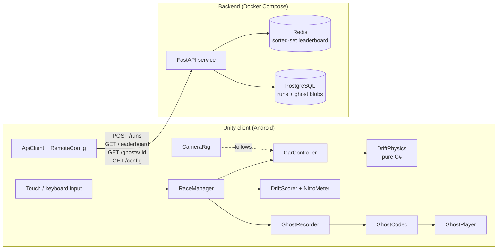

# Drift

**An arcade drift racer for Android, built in Unity (C#), with ghost replays and an online leaderboard.**

Drifting charges nitro, nitro shortens laps, and your best lap races beside you as a ghost.

> **Status: in active development.** The Unity project and the FastAPI backend are in the repo. The gameplay core and the backend are unit tested; device profiling, a playable APK and a gameplay GIF are next. Every performance number below will come from a real measurement, and until then it is marked *TBD*.

---

## At a glance

| | |
| --- | --- |
| **Engine** | Unity 6 (C#), URP with a mobile-quality profile |
| **Platform** | Android, landscape, targeting a steady 60 fps on a mid-range phone |
| **Backend** | Python FastAPI, Redis (leaderboard), PostgreSQL (runs and ghosts), Docker Compose |
| **Scope** | One car, one track, 3-lap time trials. Kept small on purpose so it can be finished and polished. |

### What this project demonstrates

| Skill | Where it shows up |
| --- | --- |
| 3D math for games | Velocity-decomposition car physics, a signed drift angle, a frame-rate independent chase camera, and quaternion interpolation in replays |
| Clean, tested C# | Gameplay math in plain C# classes with no MonoBehaviour dependencies, covered by NUnit EditMode tests |
| Performance engineering | Before and after Unity Profiler numbers on a laptop and a real Android phone, with zero GC allocations per frame while racing |
| REST API design | A FastAPI service for runs, the leaderboard, ghost downloads and remote config |
| Systems thinking | Server-side lap validation from replay data, offline-first client, remote tuning without an app update |
| AI-assisted development | A log of what was built with Claude Code and what was rewritten by hand |

---

## Quick start

**Play in the editor**
1. Open `unity/` with Unity 6 LTS (6000.0.x). On first open, `Drift > Setup Project` creates the mobile URP asset, materials, `Assets/Scenes/Main.unity` and the Android settings.
2. Open `Assets/Scenes/Main.unity` and press Play.

**Run the backend**
```bash
docker compose up --build
```
API docs are at http://localhost:8000/docs. The game works without it and shows "Offline".

**Put it on a phone**
1. Use `Drift > Build Android APK (Release)`, or the Development + Profiler build for profiling.
2. Install it with `adb install -r unity/Builds/Android/Drift.apk`.
3. In the menu, set **Server** to your laptop's LAN address, for example `http://192.168.1.10:8000`.

---

## Gameplay

A run is a 3-lap time trial on a closed circuit of about 800 m, roughly 90 seconds in all.

1. Countdown, then the car accelerates on its own.
2. Steer, and **hold Drift** to slide through corners. Drift angle × speed fills the nitro meter.
3. **Tap Nitro** on the straights to spend the meter on a speed boost.
4. Every lap is timed. Your best lap comes back as a **ghost** on the next run.
5. At the finish you see lap times, your best drift combo, your leaderboard rank, and Retry.

**Drift scoring:** points build at |drift angle| × speed per second. Drifts chained within 1.5 s raise a combo multiplier, and hitting a wall resets it. All tuning values (grip, nitro gain, combo window) come from **remote config**, so the game can be rebalanced without shipping a new build.

| Touch (landscape) | Keyboard (laptop testing) | Action |
| --- | --- | --- |
| Left thumb ◀ ▶ | A/D or arrow keys | Steer |
| Right thumb, hold **DRIFT** | Space | Lower rear grip and slide |
| Right thumb, tap **NITRO** | Shift / N | Spend the nitro meter |
| Pause button | Esc | Pause, restart, switch ghost (mine / world #1 / off) |

---

## Technical design

### Arcade car physics (no tire simulation)

The car is a Rigidbody driven by forces the code computes every physics step (50 Hz, in `FixedUpdate`). All of the math lives in a pure C# `DriftPhysics` class that depends only on `Vector3` and `Quaternion`, so it can be unit tested outside play mode.

Each step, split the velocity **v** along the car's forward axis **f** and right axis **r**:

$$v_{\text{fwd}} = (v \cdot \hat{f})\,\hat{f}, \qquad v_{\text{lat}} = (v \cdot \hat{r})\,\hat{r}$$

Grip removes sideways velocity. Holding Drift lowers the grip constant, so the car slides:

$$v \leftarrow v_{\text{fwd}} + v_{\text{lat}}\, e^{-k_{\text{grip}}\,\Delta t}$$

The exponential form gives the same result at any timestep, so the feel doesn't change if the physics rate does. The **drift angle** is the signed angle between where the car points and where it moves, around the up axis **u**:

$$\theta = \operatorname{atan2}\big((\hat{f} \times v) \cdot \hat{u},\; \hat{f} \cdot v\big)$$

Steering applies yaw torque scaled by speed, so the car can't spin in place. Nitro adds force along **f**.

### Chase camera

The camera follows a point behind the car along its **velocity** rather than its nose, so a drift visibly shows the slide. Position, rotation (`Quaternion.Slerp`) and speed-based field of view all use frame-rate independent damping:

$$p \leftarrow \operatorname{lerp}\big(p,\ p_{\text{target}},\ 1 - e^{-k\,\Delta t}\big)$$

### Ghost replays

Ghosts record **transforms, not inputs**. Unity's physics isn't guaranteed to be deterministic across devices, so replayed inputs would drift off the racing line, while recorded transforms always play back exactly.

- Recording writes position and rotation every physics step into **preallocated arrays**, so nothing is allocated during a race.
- Playback finds the two samples around the current time, lerps position and slerps rotation between them, so the ghost moves smoothly at any frame rate.
- **Compression:** positions are quantized to 16 bits per axis within the track bounds, and rotations use **smallest-three quaternion packing** (2-bit index + 3 × 10 bits). A sample shrinks from 32 bytes raw to **12 bytes**, including a sequence number. Measured by a unit test, a 30-second lap of 1,500 samples goes from 48,000 B to 18,036 B (**2.66×**), with position error around 6 mm and rotation error under 0.25°.
- Rotation components use codes 0 to 1022 rather than 0 to 1023, so 0.0 is stored exactly. Every rotation of this car is yaw-only, so its x and z components are always zero; with 1023 steps they came back about 0.14° off.
- Every sample carries a sequence number, so the server can check a submitted lap against its recorded path.

```
Header (36 B)  "DRGH" | version | rate Hz | count | bounds min xyz | bounds max xyz
Sample (12 B)  seq u16 | pos x,y,z u16 | rot u32 (smallest-three)
```

### Client architecture

| Component | Responsibility |
| --- | --- |
| `RaceManager` | Laps, checkpoints, and the state machine Countdown → Racing → Finished. One fixed tick reads the pose, records the ghost, applies forces and scores, in that order. |
| `CarController` + `DriftPhysics` | Input to forces. `DriftPhysics` is pure C# and unit tested. |
| `CameraRig` | Damped chase camera with speed-based FOV |
| `DriftScorer`, `NitroMeter` | Drift points, combo multiplier, nitro meter (pure C#, tested) |
| `GhostRecorder`, `GhostPlayer`, `GhostCodec` | Recording, playback, binary encoding (codec tested) |
| `ApiClient` + `RemoteConfig` | `UnityWebRequest` calls. Caches tuning values and falls back to built-in defaults offline. |
| `TrackBuilder` | Builds the road, curbs, walls and scenery from a JSON spline at load, so the project needs no art assets |



Only `ApiClient` touches the network. **The game runs fully offline** when the server is unreachable: local ghosts, local best laps, and cached or default tuning.

---

## Backend

A small FastAPI service, run locally with Docker Compose.

| Method | Path | Purpose |
| --- | --- | --- |
| `POST` | `/runs` | Submit a run: player name, lap times, compressed ghost of the best lap |
| `GET` | `/leaderboard?track=&limit=&player=` | Top N best laps, plus the caller's rank |
| `GET` | `/ghosts/{run_id}` | Download a ghost to race against |
| `GET` | `/config` | Tuning values: grip, nitro gain, combo window, … |

**Storage**
- **Redis:** one sorted set per track, scored by best lap in ms. `ZADD ... LT` means only a faster lap replaces a player's entry; `ZRANGE` gives the top N and `ZRANK` the player's position. A small Lua script updates the score and the player's ghost link in one atomic step.
- **PostgreSQL:** a `runs` table (id, player, track, lap times, created_at, validated) with the ghost stored as `bytea` (a few tens of KB each).

**Server-side lap validation (basic anti-cheat)**

The client can't be trusted, so the server replays the ghost's path before accepting a lap:
- Sequence numbers are continuous, and the sample count matches the claimed lap time at 50 Hz.
- Speed between consecutive samples never exceeds the car's top speed with nitro.
- The path crosses every checkpoint gate in order, using the same track definition the client loads.

A run that fails is stored with `validated = false` and kept off the leaderboard. This won't stop a determined cheater, but it's a realistic first layer. It is tested by tampering with ghosts and checking that the server rejects them. With the stack running:

```bash
cd backend && python -m tools.cli demo
```

```
honest       -> validated: True,  rank 1
teleport     -> validated: False, reason too_fast
drop         -> validated: False, reason sample_count_mismatch
shortcut     -> validated: False, reason checkpoints_missed
speedup      -> validated: False, reason sample_count_mismatch
edited time  -> validated: False, reason sample_count_mismatch
```

`python -m tools.cli tamper lap.bin bad.bin --mode shortcut` edits a ghost by hand, and `tools.cli submit` sends it.

**Remote config:** `/config` retunes grip or nitro without a new APK, the same idea live-service games use for balance changes and timed events.

---

## Tests

| Suite | How to run | Tests |
| --- | --- | --- |
| Unity EditMode: physics, scoring, laps, ghost codec, recorder | Window > General > Test Runner > EditMode > Run All | 57 |
| The same tests on plain .NET, no Unity needed | `docker run --rm -v "$PWD":/src -w /src mcr.microsoft.com/dotnet/sdk:8.0 dotnet test tools/core-tests` | 57 |
| Backend: codec, validation, API | `cd backend && pip install -r requirements-dev.txt && pytest` | 37 |

`tools/core-tests` compiles the real `Drift.Core` sources and tests against a small stand-in for Unity's math types. A ghost written by the C# encoder is checked by the Python tests, which decode it and re-encode it to identical bytes.

---

## Performance

Budget: a steady **60 fps** on a mid-range Android phone, so under 16.7 ms per frame, aiming for **14 ms** to leave headroom for thermal throttling.

| Budget | Target |
| --- | --- |
| Frame time on device (CPU and GPU) | ≤ 14 ms |
| GC allocations per frame while racing | 0 B |
| Draw calls | ≤ 100 |
| Cold start to race start | ≤ 5 s |
| APK size | ≤ 60 MB |

**Approach**
- `Application.targetFrameRate = 60` set explicitly (mobile builds can otherwise be capped at 30), and URP with a mobile profile from day one so laptop numbers aren't flattering.
- An allocation-free HUD: numbers are drawn from cached one-character strings instead of `string.Format`, so the HUD itself doesn't create garbage.
- An in-game overlay built on `ProfilerRecorder` shows FPS, frame time, GC bytes per frame and draw calls on the device.
- Built-in experiment toggles (static batching, GPU instancing, realtime shadows) so each optimization can be measured in isolation.
- A baseline capture with the Unity Profiler and Frame Debugger first, then fixes in order of impact, each logged with its before and after numbers.

**Profiling log**

| Metric | Before | After |
| --- | --- | --- |
| Frame time (ms) | TBD | TBD |
| Draw calls | TBD | TBD |
| GC alloc per frame (B) | TBD | TBD |
| Load to race (s) | TBD | TBD |

*Filled in only with measured numbers from the Unity Profiler on a real device.* The measuring steps and the full change log are in [docs/performance-log.md](docs/performance-log.md).

---

## Roadmap

- [x] Design doc and architecture
- [x] Core gameplay: car physics, drift scoring, nitro, laps
- [x] Ghost recording, compression and playback
- [x] Unit tests for `DriftPhysics`, `GhostCodec` and scoring
- [x] FastAPI backend: runs, leaderboard, ghosts, remote config, lap validation
- [ ] Android build, device profiling, before/after performance log
- [ ] Playable APK and gameplay GIF in this README
- [ ] AI tooling log: what was generated and what was rewritten by hand ([started](docs/ai-log.md))

**Deliberately out of scope:** extra cars or tracks, real-time multiplayer (ghosts give the feeling of racing someone without the networking risk), monetization, an iOS build, and realistic tire simulation. Arcade feel is the goal.

---

## Project layout

```
unity/Assets/Drift/Scripts/Core    pure C#: physics, scoring, laps, ghost codec (unit tested)
unity/Assets/Drift/Scripts/Game    MonoBehaviours: car, camera, race, ghost, HUD, API client
unity/Assets/Drift/Scripts/Editor  project setup and Android build
unity/Assets/Drift/Tests/EditMode  NUnit tests
unity/Assets/Resources/Tracks      harbor.json, shared with the server
backend/                           FastAPI service, validation, tools/cli.py, pytest
tools/core-tests                   runs the core tests on .NET without Unity
docs/                              build notes, performance log, AI tool log
```

---

## Author

**Joy Kukreja**, [GitHub @ConsistentCoder365](https://github.com/ConsistentCoder365)
