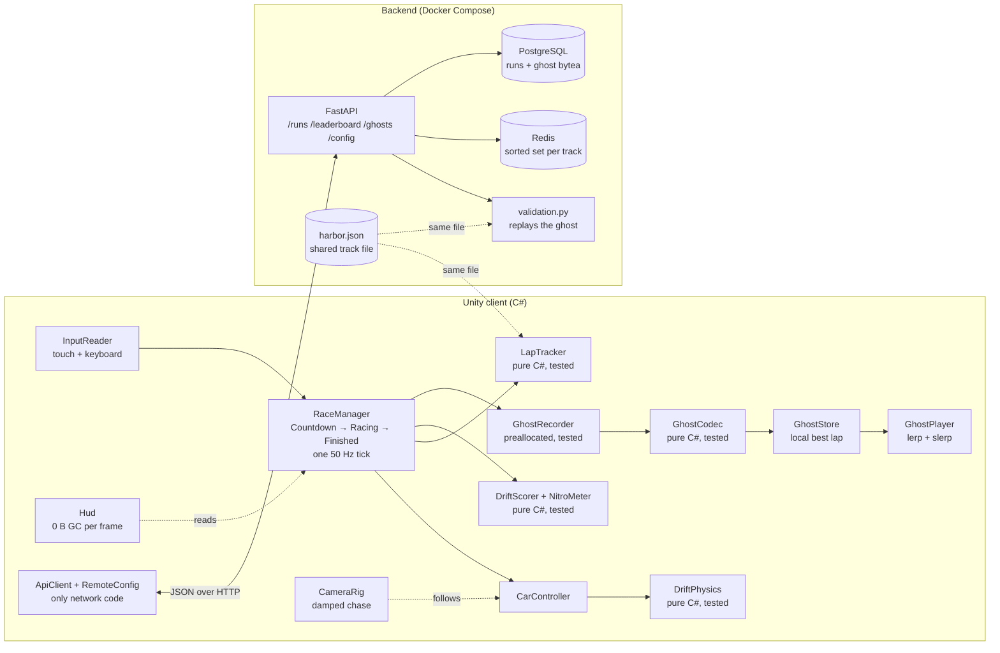

# Drift

A one-track arcade drift racer for Android, built in Unity (C#), with ghost replays and an online leaderboard. Drifting charges nitro, nitro shortens laps, and your best lap races beside you as a ghost.


<!-- Record after the first play session: a 10 s clip of a drift into a nitro boost, with the ghost visible. -->

| Posting asks for | Where Drift shows it |
| --- | --- |
| 3D mathematics used in games | Velocity-decomposition car physics, signed drift angle, damped chase camera, quaternion slerp and smallest-three compression in ghosts ([DriftPhysics.cs](unity/Assets/Drift/Scripts/Core/DriftPhysics.cs), [CameraRig.cs](unity/Assets/Drift/Scripts/Game/CameraRig.cs), [GhostCodec.cs](unity/Assets/Drift/Scripts/Core/GhostCodec.cs)) |
| C++ / C# / Java proficiency | Unity C# split into a pure, unit-tested core and a thin engine layer; 57 NUnit tests |
| Reducing load times and improving frame rates | Zero-allocation HUD, on-device perf overlay, toggles for each optimisation, and a [before/after log](docs/performance-log.md) |
| RESTful APIs | FastAPI service for runs, leaderboard, ghosts and remote config, with server-side lap validation ([backend/](backend/)) |
| Using agentic AI coding harnesses | [docs/ai-log.md](docs/ai-log.md) |
| Experience making and playing games | Playable APK (Drift > Build Android APK) and the GIF above |

## Quick start

### Play it in the editor

1. Open `unity/` with **Unity 6 LTS** (6000.0.x). If Unity Hub offers a different 6000.x version, take it.
2. On first open, `Drift > Setup Project` runs by itself. It creates a mobile URP asset, the shared materials, `Assets/Scenes/Main.unity`, and the Android player settings.
3. Open `Assets/Scenes/Main.unity` and press Play.

Keyboard: **A/D** or arrows steer, **Space** drifts, **Shift** or **N** fires nitro, **Esc** pauses. The touch pads also work with the mouse.

### Run the backend

```bash
docker compose up --build
```

API docs are at http://localhost:8000/docs. The game works without the server; it just shows "Offline".

### Put it on a phone

1. `Drift > Build Android APK (Release)` writes `unity/Builds/Android/Drift.apk`. Use the **Development + Profiler** build when you profile.
2. Install the APK with `adb install -r unity/Builds/Android/Drift.apk`.
3. In the game's menu, set **Server** to your laptop's LAN address, for example `http://192.168.1.10:8000`.

## How to play

A run is three laps of Harbor Loop, about 80 to 90 seconds. The car accelerates by itself after the countdown.

- **Hold DRIFT** through a corner to drop rear grip and slide. Points build at drift angle × speed per second.
- Start another drift within **1.5 s** to chain a combo: x2, x3, up to x5. Hitting a wall loses the combo.
- Drift points fill the **nitro** meter. **Tap NITRO** on a straight to spend the whole meter on a boost.
- Your best lap is saved as a ghost and races you next time. In the pause menu, the ghost can be your best, the leaderboard's #1, or off.

## Architecture



Only `ApiClient` talks to the network. If the server is down, the game falls back to cached or built-in tuning and keeps ghosts locally.

### Car physics

Each physics step, velocity is split along the car's forward and right axes. Grip then removes the sideways part as `v ← v_fwd + v_lat·e^(−k·Δt)`. The exponential form gives the same result at any timestep, and a test checks 50 Hz against 25 Hz. Holding Drift drops `k` from 20 to 3.5. The result is a slide, and its signed drift angle is `atan2((f × v)·u, f·v)`.

Pure grip throws away the speed it removes, so long slides would stall the car. Arcade racers hand most of that speed back along the new direction of travel, and `slide_momentum_keep` controls how much. Steering applies yaw torque that scales with speed, so a stopped car can't spin.

The tests drive a small simulation with the same functions. With the default tuning, normal cornering stays under the 8° drift threshold. Holding Drift reaches 25 to 90° of slide and keeps more than 60% of the speed.

### Ghost replays

The recorder stores transforms, not inputs: Unity physics isn't deterministic across devices, so replayed inputs would drift off the line. It records every physics step into preallocated arrays, so nothing is allocated during a run.

| | Raw | Encoded |
| --- | --- | --- |
| One sample | 32 B (7 floats + sequence number) | 12 B: u16 sequence, 3 × u16 position, u32 smallest-three rotation |
| 1,500-sample lap (30 s), measured by `Encode_IsAboutTwoAndAHalfTimesSmallerThanRaw` | 48,000 B | 18,036 B (**2.66×**) |

Positions are quantised to 16 bits per axis inside the track bounds (about 6 mm on this track). Rotations drop their largest component and store the other three in 10 bits each, with worst-case error under 0.25°. The codes run 0 to 1022 rather than 0 to 1023, so 0.0 is exact. That matters here because every rotation of this car is yaw-only.

Playback finds the two samples around the current time, lerps position and slerps rotation. The format is mirrored in [backend/app/ghost.py](backend/app/ghost.py). A fixture written by the C# encoder is decoded and re-encoded byte-for-byte by the Python tests.

## Backend

| Method | Path | Purpose |
| --- | --- | --- |
| POST | `/runs` | Submit a run: player name, lap times, base64 ghost of the best lap |
| GET | `/leaderboard?track=&limit=&player=` | Top N best laps, plus the caller's rank |
| GET | `/ghosts/{run_id}` | Download a validated ghost |
| GET | `/config` | Tuning values. The file is re-read on every call, so editing `backend/config/tuning.json` retunes the game without a new APK |

- **Redis:** one sorted set per track, scored by best lap in ms. A Lua script runs `ZADD LT CH` and records which run set the time in one atomic step, so only a faster lap replaces a player's entry. `ZRANGE` gives the top N and `ZRANK` the caller's rank.
- **PostgreSQL:** a `runs` table with the ghost as `bytea`. Every run is stored, and rejected runs keep `validated = false` with the reason.

**Validation.** The server re-checks the ghost before a lap reaches the leaderboard:

- The sample count must equal lap ms / 20 + 1, and sequence numbers must be continuous (wrap-around allowed).
- No step may move further than the nitro top speed × 1.15 allows.
- The path must start just past the line, cross every checkpoint gate in order, and finish on the line in the last step.

The gates come from the same `harbor.json` the game builds the track from. Test it against the running stack:

```bash
cd backend && python -m tools.cli demo
```

```
honest       -> validated: True,  rank 1
teleport     -> validated: False, reason too_fast
drop         -> validated: False, reason sample_count_mismatch
shortcut     -> validated: False, reason checkpoints_missed
speedup      -> validated: False, reason sample_count_mismatch
edited time  -> validated: False, reason sample_count_mismatch
```

To tamper with a ghost by hand, use `python -m tools.cli tamper lap.bin bad.bin --mode shortcut` and submit it with `tools.cli submit`. This is a first layer of defence, not real anti-cheat: someone who generates a plausible path at legal speeds still gets through.

## Tests

| Suite | Command | Count |
| --- | --- | --- |
| Unity EditMode (physics, scoring, laps, ghost codec, recorder) | Unity: Window > General > Test Runner > EditMode > Run All | 57 |
| Same tests on plain .NET, no Unity needed | `docker run --rm -v "$PWD":/src -w /src mcr.microsoft.com/dotnet/sdk:8.0 dotnet test tools/core-tests` | 57, plus a fixture writer that is skipped unless `DRIFT_WRITE_FIXTURES=1` |
| Backend (codec, validation, API) | `cd backend && pip install -r requirements-dev.txt && pytest` | 37 |

`tools/core-tests` compiles the real `Drift.Core` sources and EditMode tests against a small `UnityEngine` math stand-in. That lets the maths run in CI, or on a machine without Unity.

## Performance

The target is a steady 60 fps on a mid-range phone, which means 14 ms frames or less, and 0 B of GC per frame while racing. The [performance log](docs/performance-log.md) has the budgets, the measuring steps, and the before/after table to fill in.

- An overlay (bottom centre) shows FPS, average and worst frame ms, GC bytes per frame, draw calls and batches.
- The `DriftGame` component has a checkbox for each optimisation: static batching, GPU instancing, realtime shadows, scenery. Turning one off reproduces the "before".
- Built in from the start: `Application.targetFrameRate = 60`, a mobile URP profile, one shared material per colour, a zero-allocation HUD (`NumberLabel`), no `GetComponent` or LINQ per frame, reused collision callbacks, and preallocated ghost buffers.

## Project layout

```
unity/Assets/Drift/Scripts/Core    pure C#: physics, scoring, laps, ghost codec (unit tested)
unity/Assets/Drift/Scripts/Game    MonoBehaviours: car, camera, race, ghost, HUD, API client
unity/Assets/Drift/Scripts/Editor  project setup and Android build
unity/Assets/Drift/Tests/EditMode  NUnit tests
unity/Assets/Resources/Tracks      harbor.json (shared with the server)
backend/                           FastAPI, validation, tools/cli.py, pytest
tools/core-tests                   runs the core tests on .NET without Unity
docs/                              performance log, AI tool log
```

## Assets

All art is generated in code from primitives, and the game needs no imported assets. To use a Kenney Car Kit model, put a prefab named `CarModel` in any `Resources` folder. Children whose names contain "wheel" will spin, and "front" wheels steer.

## Future work

Not before the ship date: a second track, car selection, engine audio, ghost blobs in S3, and server-side replay of physics for stronger validation.
